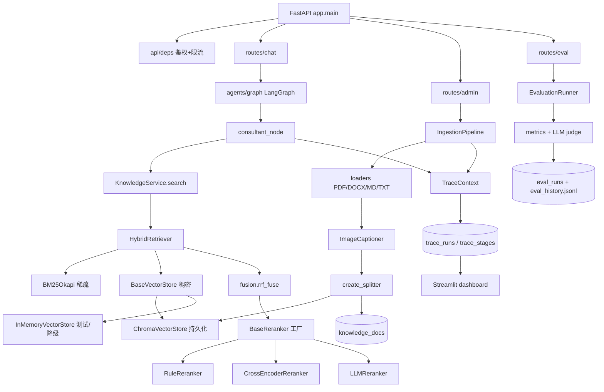

# DEV_SPEC · Smart Agent Platform

> 本文档是开发的唯一规格来源。代码与文档冲突时以本文档为准；
> 需要变更行为时先改本文档，再改代码。
> 配套 Skill：`auto-coder`（按规格生成代码）、`qa-tester`（回归与归因）、`package`（打包发版）。

---

## 1. 项目定位

面向多租户的智能客服 Agent 平台：LangGraph 多 Agent 编排 + 混合检索 RAG + MCP 工具协议，
并具备完整的知识摄取、索引持久化、链路追踪、质量评估与可视化运营能力。

一句话验收标准：**一个不懂代码的运营，能通过控制台上传文档、看到检索过程、跑出评测报告。**

---

## 2. 架构



### 分层约定

| 层 | 目录 | 职责 | 允许依赖 |
|---|---|---|---|
| 接口层 | `app/api/` | 参数校验、鉴权、响应序列化 | 服务层 |
| 编排层 | `app/agents/` | LangGraph 节点与路由 | 服务层、LLM 层、MCP 层 |
| 服务层 | `app/services/` | 业务用例（检索、记忆、画像） | 检索层、数据层 |
| 检索层 | `app/rag/` | 向量库、BM25、融合、重排 | LLM 层（embedding） |
| 摄取层 | `app/ingestion/` | 解析、描述、分块、去重、入库 | 检索层、LLM 层 |
| 可观测层 | `app/observability/` | trace、评估 | 数据层 |
| 数据层 | `app/db/` | ORM 模型与迁移 | 无 |

**铁律**：下层不得反向依赖上层；`app/rag/` 不得 import `app/api/`。

---

## 3. 模块契约

### 3.1 向量库 `app/rag/base.py::BaseVectorStore`

```python
upsert(ids: list[str], documents: list[str], metadatas: list[dict], embeddings: list[list[float]]) -> None
delete(ids: list[str]) -> None
query(query_embedding: list[float], n_results: int = 10, where: dict | None = None) -> list[VectorHit]
count() -> int
reset() -> None
```

- `VectorHit.score` 为余弦相似度，范围 `[0, 1]`，越大越相关。
- `where` 语法：`{"category": {"$eq": "价格"}}`、`{"source": {"$in": ["a.pdf"]}}`。
- **实现约束**：Chroma 必须显式传 `embeddings=`，禁止使用其默认 ONNX 嵌入函数。

### 3.2 融合 `app/rag/fusion.py`

```python
rrf_fuse(rankings: list[list[int]], weights: list[float] | None = None, k: int = 60) -> dict[int, float]
weighted_fuse(sparse: np.ndarray, dense: np.ndarray, w_s: float, w_d: float, normalize: str = "minmax") -> np.ndarray
normalize_scores(scores: np.ndarray, method: str = "minmax") -> np.ndarray
```

- RRF 中 `rank` 从 1 开始，贡献 `weight / (k + rank)`。
- 归一化遇到「全部同分」返回全 0（表示无区分度），不得除零。

### 3.3 重排 `app/rag/base.py::BaseReranker`

```python
rerank(query: str, hits: list[RetrieverHit], top_k: int | None = None) -> list[RetrieverHit]
```

- 三种实现必须行为一致：失败时**保持融合顺序**并写 WARNING，不得伪造分数。
- `RetrieverHit.rerank_score` 记录重排分，与 `score`（融合分）并存。

### 3.4 检索服务 `app/services/knowledge_service.py`

```python
search(db, tenant_id, query, top_k=5, rerank=True, where=None) -> list[dict]
```

返回字段固定为 `doc_id / content / category / score / source / rerank_score`（只允许追加，不允许删除）。

### 3.5 摄取 `app/ingestion/pipeline.py`

```python
run(db, tenant_id, path, force=False, with_caption=True, category="文档导入") -> IngestResult
run_directory(db, tenant_id, directory, ...) -> list[IngestResult]
```

状态机：

| 结果 | 触发条件 | 是否写 `ingestion_records` |
|---|---|---|
| `success` | 解析成功且至少写入 1 块 | 是 |
| `skipped` | 同 `(tenant_id, source_hash)` 已成功，或全部块重复 | 仅第二种情况写 |
| `failed` | 文件不存在、格式不支持、解析/索引异常 | 是 |

一致性要求：先 `flush()` 拿 id 建索引，成功后再 `commit()`；失败 `rollback()`。

### 3.6 追踪 `app/observability/trace.py`

```python
trace_scope(kind: str, tenant_id: int = 0, query: str = "", persist: bool = True) -> ContextManager[TraceContext]
record_stage(name: str, **payload) -> None   # 无 trace 时静默
```

- payload 截断：单字符串 ≤ 300 字符，单列表 ≤ 20 项，单 trace ≤ 50 阶段。
- 落库失败只记 WARNING，绝不影响业务返回。

### 3.7 评估 `app/observability/evaluation/`

指标口径：

| 指标 | 定义 | 无标注时 |
|---|---|---|
| Hit@k | Top-k 中存在 `category == expected_category` | - |
| Recall@k | `expected_keywords` 在 Top-k 正文中的覆盖率 | `None` |
| MRR | 首个命中分类的 `1/rank` | - |
| ContextPrecision@k | Top-k 中命中至少一个关键词的条目占比 | `None` |
| Faithfulness | LLM 判定答案是否忠于上下文 | `None` + `judge_failed` |

**禁止**：判定失败时回填默认分。报告里 `None` 与 `0.0` 含义必须区分。

### 3.8 接口契约

| 方法 | 路径 | 鉴权 | 说明 |
|---|---|---|---|
| GET | `/api/health` | 否 | 存活探针 |
| GET | `/api/tenants` | 是 | 租户列表 |
| POST | `/api/chat` | 是 | 对话，返回 `trace_id` |
| POST | `/api/chat/stream` | 是 | SSE：meta/node/delta/done/error |
| POST | `/api/kb/search` | 是 | 检索调试，返回 `trace_id` |
| GET | `/api/kb/stats` | 是 | 知识统计 |
| POST | `/api/eval/run` | 是 | 运行评测 |
| POST | `/api/admin/ingest` | 是 | 上传并摄取 |
| POST | `/api/admin/ingest/rebuild` | 是 | 重建索引 |
| GET | `/api/admin/ingestions` | 是 | 摄取记录 |
| GET | `/api/admin/traces` | 是 | 链路列表 |
| GET | `/api/admin/traces/{id}` | 是 | 链路阶段详情 |
| GET | `/api/admin/overview` | 是 | 总览指标 |
| GET | `/api/admin/collections` | 是 | 租户与集合 |

鉴权：`X-API-Key` 或 `Authorization: Bearer <key>`。
未配置 `API_KEY` 且 `ALLOW_UNAUTHENTICATED != true` → **503**；密钥错误 → **401**；超限 → **429**。

---

## 4. 数据模型

| 表 | 关键字段 | 说明 |
|---|---|---|
| `tenants` | `name/industry` | 租户 |
| `knowledge_docs` | `content/category/keywords/source/source_hash/content_hash/chunk_index/doc_group/page/is_active` | 知识块 |
| `ingestion_records` | `filename/source_hash/status/chunks/images/elapsed_ms/error/trace_id` | 摄取记录 |
| `trace_runs` | `trace_id/kind/status/total_ms` | 链路根 |
| `trace_stages` | `trace_id/seq/name/elapsed_ms/payload` | 链路阶段 |
| `eval_runs` | `top1_accuracy/top3_accuracy/metrics/config` | 评测历史 |
| `conversations` | `session_id/intent/sources` | 会话快照 |
| `booking_tickets` | `service_type/appointment_time/status` | 工单 |
| `user_behaviors` / `user_profiles` | - | 事件溯源与画像 |
| `memory_entries` | `user_key/memory_type/importance` | 跨会话记忆 |

迁移策略：`create_all` 建新表；存量表新增列由 `database._ensure_legacy_columns()` 幂等 `ALTER TABLE` 补齐。
**禁止**删除既有数据文件；索引结构变更时改名保留旧目录。

---

## 5. 配置项

见 `.env.example`，分组：LLM / Embedding / Vision / 检索（融合、候选数、向量库、重排器）/ 摄取 / 访问控制 / MCP。

默认值必须保证「不改变旧行为」：
- `VECTOR_STORE=chroma` 首次启动自动从 SQLite 构建，失败回退内存并记 ERROR；
- `FUSION_STRATEGY=rrf` 为默认，`weighted` 可回到旧算法；
- `RERANKER_PROVIDER=rule` 与旧实现完全一致。

---

## 6. 任务分解与状态

| # | 任务 | 产出 | 状态 |
|---|---|---|---|
| 1 | 配置与数据模型 | `settings.py`、`models.py`、`database.py` 迁移、`rag/base.py`、`rag/factory.py` | 完成 |
| 2 | 检索内核 | `vector_store.py`、`fusion.py`、`rerankers/*`、`hybrid_retriever.py` | 完成 |
| 3 | 文档摄取 | `ingestion/*`、`llm/vision.py`、`scripts/ingest_docs.py` | 完成 |
| 4 | 链路追踪 | `observability/trace.py`、对话与摄取接入 | 完成 |
| 5 | 评估体系 | `evaluation/*`、golden set 36 条、`scripts/build_golden_set.py` | 完成 |
| 6 | 控制台 | `dashboard/` 六页 + `scripts/run_dashboard.py` | 完成 |
| 7 | MCP 闭环 | 修复 client、新增 3 个知识工具、ReAct 接入 | 完成 |
| 8 | 鉴权与部署 | `api/deps.py`、`ratelimit.py`、Dockerfile、compose、CI | 完成 |
| 9 | 规格与测试 | 本文档、3 个 Skill、6 个测试文件 | 完成 |

---

## 7. 验收标准（可执行）

```bash
# 1) 单元与集成测试(不依赖模型密钥)
pytest -m "not e2e"

# 2) golden set 结构校验
python scripts/build_golden_set.py --strict

# 3) 评估回归(需要 EMBEDDING_API_KEY)
python scripts/run_eval.py --top_k 3
python scripts/run_eval.py --with-judge

# 4) 文档摄取
python scripts/ingest_docs.py --path data/docs --no-caption

# 5) 控制台
python scripts/run_dashboard.py

# 6) 容器
docker compose up --build
```

硬性验收项：

- [ ] `POST /api/admin/ingest` 上传 PDF 后,`ingestion_records` 有 `success` 记录且 `chunks > 0`
- [ ] 重启进程后同一 query 的检索结果不变（向量持久化生效）
- [ ] 更换 `EMBEDDING_MODEL` 后启动，抛 `EmbeddingIdentityMismatch` 并提示改名保留
- [ ] `trace_stages` 中能看到 `bm25 → dense → fuse → retrieve` 四个阶段
- [ ] 评测报告含 `metrics.recall`、`metrics.mrr`、`config.fusion_strategy`
- [ ] 未配置 `API_KEY` 时 `POST /api/chat` 返回 503

---

## 8. 扩展点

| 想加什么 | 改哪里 | 不需要改什么 |
|---|---|---|
| 新向量库（Qdrant） | 实现 `BaseVectorStore` + 在 `factory.create_vector_store` 注册 | 业务代码 |
| 新重排器（Cohere Rerank） | 实现 `BaseReranker` + 注册到 `_register_rerankers()` | `Reranker` 门面 |
| 新文档格式（HTML） | 实现 `BaseLoader` + 加进 `_LOADERS` | 流水线 |
| 新评估指标 | 在 `metrics.py` 加函数 + `runner` 汇总 | 报告结构（只追加字段） |
| 多副本部署限流 | 把 `ratelimit.check_rate_limit` 换成 Redis 实现 | 路由 |
