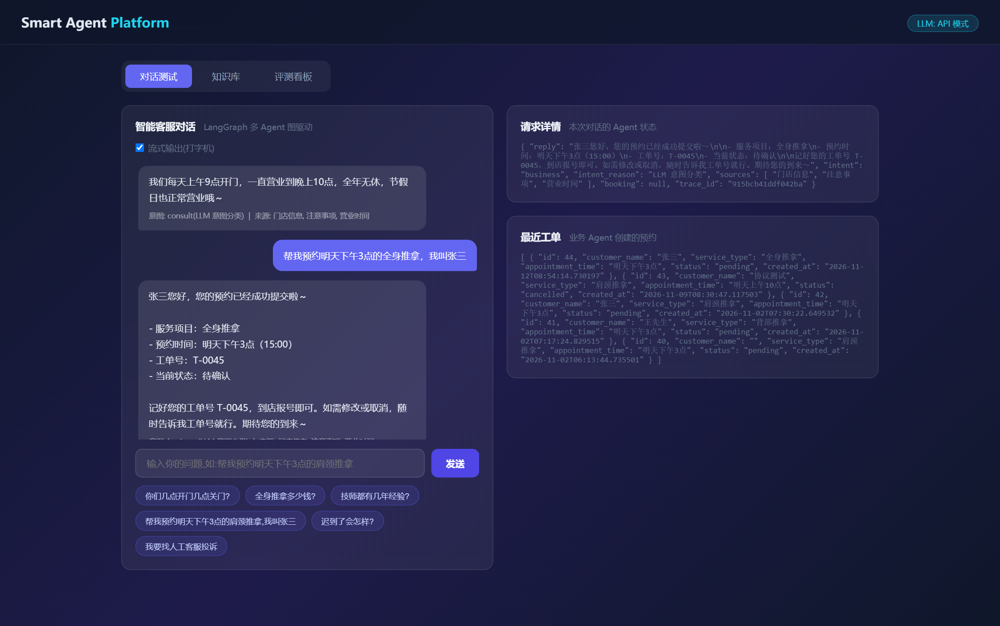
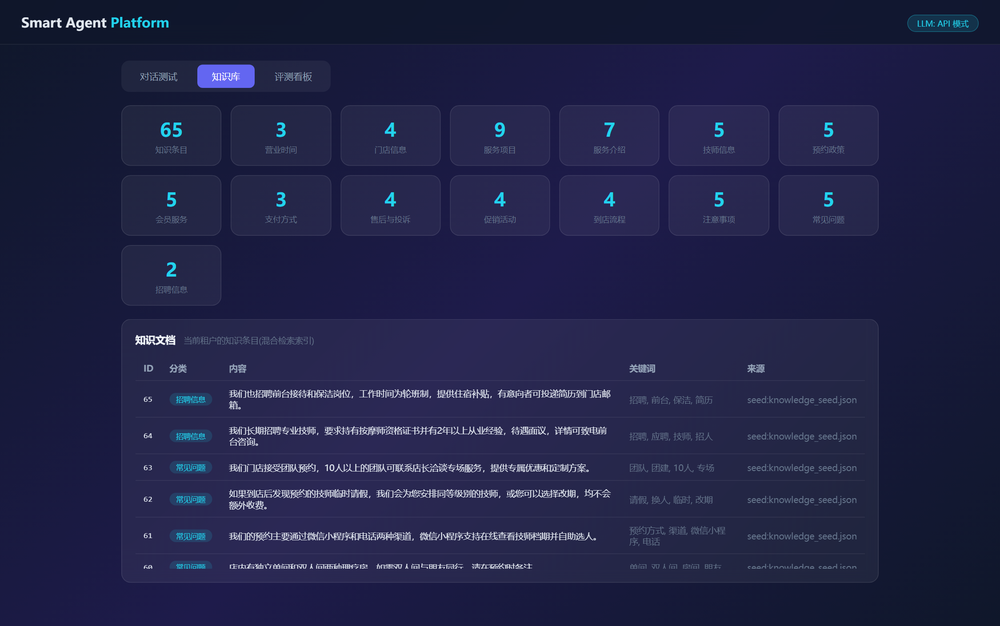
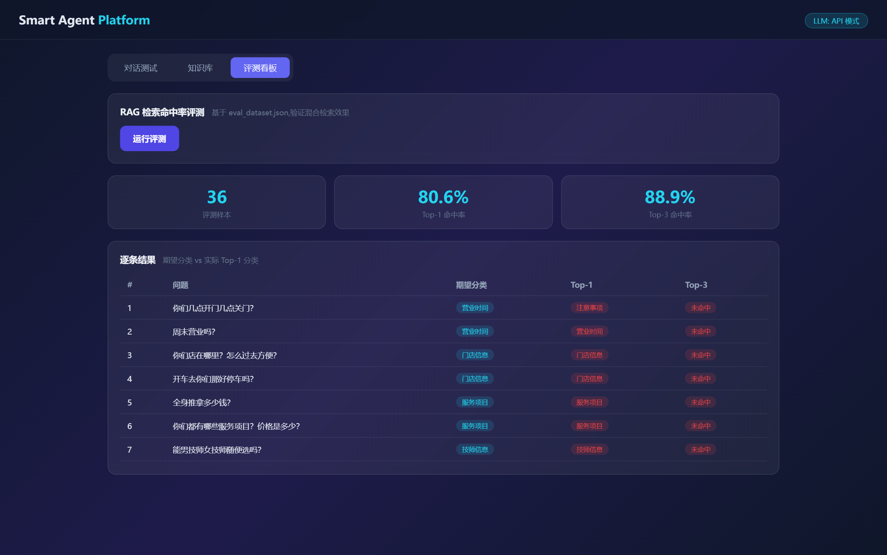
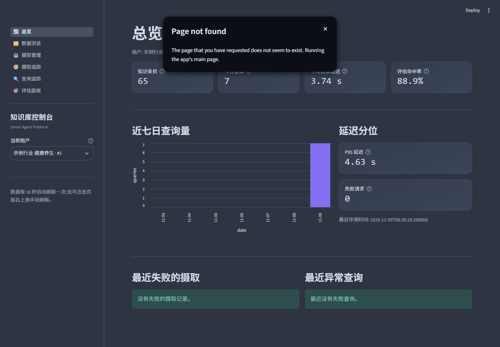
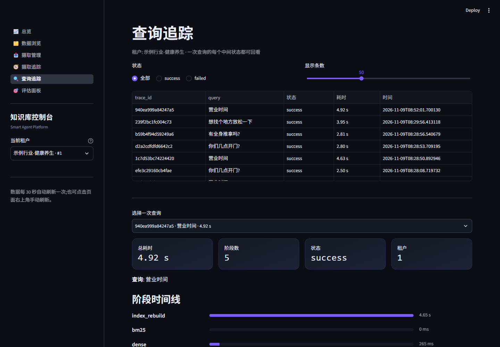
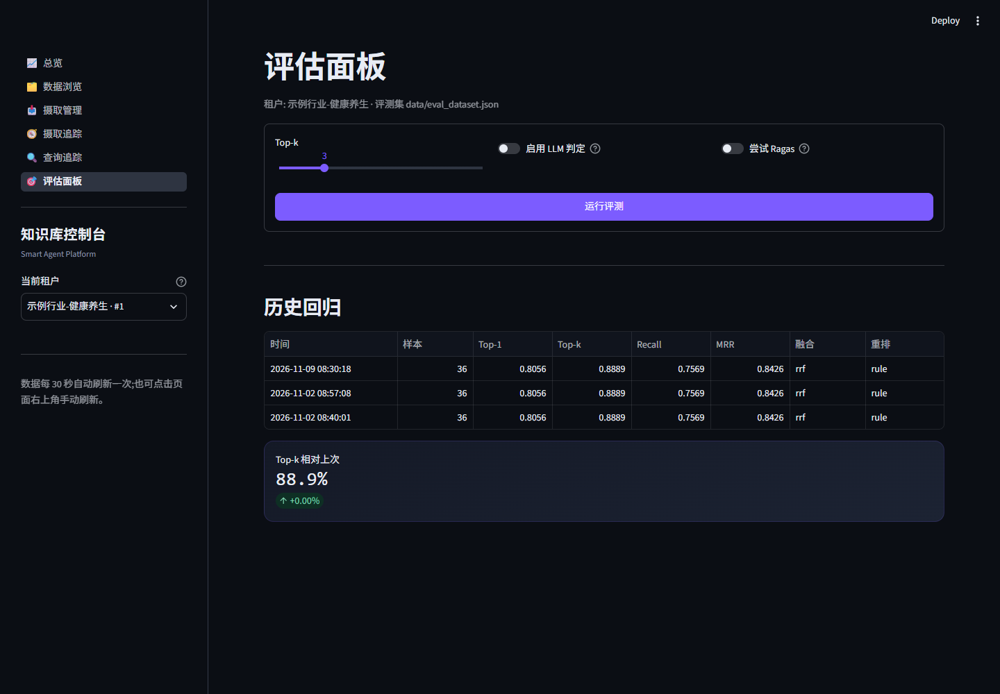
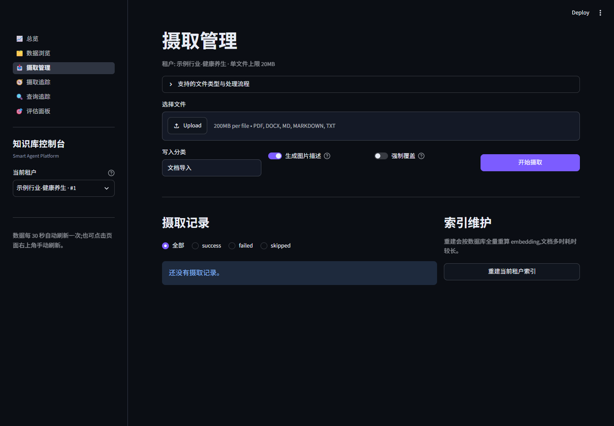

# Smart Agent Platform · 可配置多行业的智能客服 Agent

> 把「查知识、办业务、记客户」三件事交给一支 Agent 团队：主管判断意图，专员各干各的活。
> 接入新行业只换知识库，不改代码。

一套跑在本地或容器里的智能客服平台。用户用自然语言提问，系统自己决定是查知识库、建预约工单、调用户画像，还是转人工；每一次回答都带知识来源，每一次检索都可回放。

---

## 目录

- [这个项目解决什么问题](#这个项目解决什么问题)
- [Demo 截图](#demo-截图)
- [一次完整对话长什么样](#一次完整对话长什么样)
- [核心能力](#核心能力)
- [三分钟跑起来](#三分钟跑起来)
- [效果数据](#效果数据)
- [适用与不适用](#适用与不适用)
- [技术实现](#技术实现)
- [项目结构](#项目结构)
- [Roadmap](#roadmap)

---

## 这个项目解决什么问题

市面上的客服机器人大多卡在三个地方：

| 现状 | 后果 | 本项目的做法 |
|---|---|---|
| 只会查 FAQ | 用户说「帮我约明天下午三点」时直接失能 | 主管 Agent 先判意图，业务类请求交给能调工具的业务 Agent，真的把工单写进数据库 |
| 检索靠关键词硬匹配 | 「想歇会儿」找不到「足底按摩」，「几点关门」又因为改写而漏掉 | BM25 稀疏检索 + 向量稠密检索双路召回，融合后再重排 |
| 客户信息只存在工单表里 | 老客户换一次会话，系统就不认识他了 | 行为事件 → 画像聚合 → 跨会话长期记忆，三层分开存放 |
| 换一个行业就要改一遍代码 | 平台化做不下去 | 知识库按 `tenant_id` 隔离，加一个租户只导入一份文档 |

这个项目把上面四件事都做完了，并且每一层都有测试和评测数据兜底。

## Demo 截图

### Web 对话：一个输入框，接住问答、预约与画像



第一轮问营业时间，主管 Agent 判定为咨询意图，检索命中知识后附来源；第二轮直接说「帮我预约明天下午 3 点的全身推拿，我叫张三」，业务 Agent 抽出三个要素、经 MCP 建单，返回工单号 T-0045。右栏实时显示本次请求的 Agent 状态与最近工单。

### 知识库：按租户隔离的知识条目，带分类与来源



65 条种子知识分布在 13 个分类下，每条都带关键词与来源标记，可直接看到检索器会拿到什么。

### 评测看板：改完参数立刻知道命中率变化



36 条 golden set 跑完给出 Top-1 / Top-3 命中率，逐条列出「期望分类 vs 实际 Top-1」，未命中的可以马上定位是召回问题还是排序问题。

### 运营控制台：日常运营与问题排查

控制台六页覆盖「看数据 / 管知识 / 排问题 / 跑评测」。

#### 总览：一眼看到今天系统健不健康



知识条目数、今日查询量、平均与 P95 延迟、最近一次评测命中率、近七日趋势，都在这一个页面。

#### 查询追踪：回答不准时能查到第几毫秒出的问题



每一次查询都落一条链路：`index_rebuild` → `bm25` → `dense` → `fuse` → `rerank` 每个阶段的耗时、候选、融合分与重排分全部保留。上图这次"营业时间"查询走了 5 个阶段，总耗时 4.92 秒。

#### 评估面板：改了参数，命中率是涨还是跌



跑一遍 golden set，直接看 Top-1 / Top-k / Recall@k / MRR / ContextPrecision，未命中的用例可以逐条下钻，历史结果自动攒成回归曲线。

#### 摄取管理：拖一份 PDF 进去就变成可检索知识



支持 PDF / Word / Markdown / TXT，图片可以交给视觉模型生成描述并回填到原位；同一份文件重复导入会自动跳过。

## 一次完整对话长什么样

用户：「帮我预约明天下午 3 点的全身推拿，我叫张三」

1. **主管 Agent** 判断这是业务意图，路由到业务节点
2. **业务 Agent** 从这句话里抽出三个要素：服务=全身推拿、时间=明天 15:00、姓名=张三
3. 调 **MCP 工具** `create_booking` 写入 `booking_tickets` 表，拿到工单号
4. 同时往 `user_behaviors` 记一条 `appointment` 行为事件，往 `memory_entries` 记一条长期记忆
5. 回复用户确认信息，并把本条会话状态写进 `SqliteSaver` 检查点

用户接着问：「你们几点开门？」

1. 主管判断为咨询意图，路由到咨询 Agent
2. 咨询 Agent 调检索器 → BM25 召回 + 向量召回 → RRF 融合 → 规则重排
3. 命中「营业时间」知识条目，生成回答并**附带来源**
4. 整条链路落进 `trace_runs` / `trace_stages`，控制台可回放

用户过两周换了个会话再问：「我常做什么项目？」

1. 主管召回该 `user_key` 的长期记忆与画像
2. 画像 Agent 聚合历史行为：常做全身推拿、偏好下午、平均时长 90 分钟
3. 回答带上个性化信息，无需用户重复自我介绍

## 核心能力

### 对话能力

| 能力 | 说明 |
|---|---|
| 多 Agent 协作 | 主管意图路由 + 咨询 / 画像 / 业务 / 转人工四条支线，LangGraph 状态图编排 |
| 混合检索 RAG | BM25（稀疏）+ 向量（稠密）双路召回，支持 RRF 与归一化加权两种融合策略 |
| 三级重排 | 规则重排 / Cross-Encoder 重排 / LLM listwise 重排，配置切换 |
| 流式输出 | `POST /api/chat/stream` 通过 SSE 推送节点进度与增量文本，前端实时显示处理到哪个 Agent |
| 长对话压缩 | 超过 8 轮自动折叠旧历史为摘要，只把「摘要 + 最近 4 轮」送进模型 |
| 跨会话记忆 | 按 `user_key` 召回历史事实，新会话仍记得老客户 |
| 自主决策 | 配置真实模型 key 后，业务请求走 ReAct 循环，模型自己决定连续调用哪几个工具 |
| 多轮业务补全 | 预约信息不全会逐项追问，中途换话题再回来仍能接上 |

### 业务与数据能力

| 能力 | 说明 |
|---|---|
| MCP 标准工具 | 预约创建 / 查询 / 取消、天气查询、知识检索、集合列表、文档摘要，共 7 个工具 |
| 多租户隔离 | 知识库、工单、画像、记忆全部按 `tenant_id` 隔离，检索不串台 |
| 行为事件溯源 | 只写不可变行为事件（预约 / 取消 / 改期 / 咨询），画像由聚合实时计算 |
| 用户画像 | 常做服务、偏好时段、偏好时长、总次数、最近预约时间 |
| 回访营销 | 距最近预约超过阈值时自动生成个性化回访邀约 |

### 工程与运营能力

| 能力 | 说明 |
|---|---|
| 文档摄取 | PDF 按页保序、Word / Markdown 解析、图片描述回填、文件级 + 块级双层去重 |
| 持久化向量库 | Chroma 按租户一个 collection 落盘，重启不重建；附带 embedding 身份校验，换模型会拒绝打开旧索引 |
| 全链路追踪 | 查询链路与摄取链路双记录，阶段耗时与中间分数入库 |
| 运营控制台 | Streamlit 六页：总览 / 数据浏览 / 摄取管理 / 摄取追踪 / 查询追踪 / 评估面板 |
| 评测体系 | 36 条 golden set，Hit@k / Recall@k / MRR / ContextPrecision + LLM 忠实度判定 |
| 访问控制 | API Key 鉴权（未配置时拒绝服务而非裸奔）+ 进程内滑动窗口限流 |
| 容器化 | `docker-compose.yml` 三服务：应用 8000 / MCP 9000 / 控制台 8501 |

## 三分钟跑起来

```bash
# 1. 装依赖
python -m venv .venv
.\.venv\Scripts\activate        # macOS/Linux: source .venv/bin/activate
pip install -r requirements.txt

# 2. 配置模型（任何 OpenAI 兼容端点都可以：通义 / DeepSeek / 智谱 / 火山方舟）
copy .env.example .env
#   LLM_API_KEY=sk-xxx
#   LLM_MODEL=qwen-plus
#   LLM_BASE_URL=https://dashscope.aliyuncs.com/compatible-mode/v1
#   EMBEDDING_API_KEY=sk-xxx
#   EMBEDDING_MODEL=text-embedding-v3

# 3. 启动
python scripts/run_web.py
# 浏览器打开 http://127.0.0.1:8000/web/
```

首次启动会自动建表并导入 65 条种子知识。想开运营控制台另开一个终端：

```bash
pip install streamlit
python scripts/run_dashboard.py     # http://127.0.0.1:8501
```

常用命令：

```bash
python scripts/import_knowledge_seed.py --replace   # 重建种子知识
python scripts/ingest_docs.py --path data/docs      # 导入自己的 PDF / Word / Markdown
python scripts/run_eval.py --top_k 3                # 跑评测
python scripts/demo_chat.py                         # 纯命令行对话
python -m pytest -m "not e2e"                        # 跑测试
```

> 关于「无伪降级」：未配置真实 key 时接口会明确报错，不会用模板文字或哈希向量冒充模型输出。扩展能力同理——没有 key 时 ReAct 自动回退规则流程、摘要回退规则摘要，但绝不伪造模型结果。

## 效果数据

36 条 golden set（14 个分类，含 easy / medium / hard 难度标注），配置为 `chroma + rrf(k=60) + rule rerank + top_k=3`：

| 指标 | 结果 | 口径 |
|---|---|---|
| Top-1 分类命中率 | **80.6%** (29/36) | 首条召回即命中期望分类 |
| Top-3 分类命中率 | **88.9%** (32/36) | 期望分类进入 Top-3 |
| Hit@3 | 88.9% | Top-3 中是否出现期望分类 |
| Recall@3 | 75.7% | `expected_keywords` 在 Top-3 正文中的覆盖率 |
| MRR | 0.843 | 首个命中分类的倒数排名 |
| ContextPrecision@3 | 35.2% | Top-3 中命中关键词的条目占比 |
| 单次全量评测耗时 | 11.6 s | 36 条串行检索 |

数据来源：`data/eval_report.json`（2026-11-09），可随时用 `python scripts/run_eval.py` 复现。

> 说明：早期 26 条简易集上 Top-1 曾达到 92.3%。扩充到 36 条并加入 hard 难度用例后回落到 80.6%——这是评测集变难导致的，不是实现退化。同一份报告里 Top-3 仍有 88.9%，说明期望内容基本都进了候选，主要损耗在排序而非召回。

## 适用与不适用

**适合**

- 需要一个能同时处理「问答 + 预约 + 客户画像」的客服 Agent 参考实现
- 想研究多 Agent 路由、混合检索、上下文工程怎么落地到真实业务
- 要一套带评测、带追踪、带控制台的完整工程骨架，而不是一个 demo 脚本

**不适合**

- 上万条知识的超大知识库：当前 BM25 是内存实现，适合几千条量级
- 强一致性的交易场景：限流是进程内单机实现，多副本需要换 Redis
- 需要原生多模态输入的场景：当前视觉能力只用于文档内的图片描述

## 技术实现

完整的技术说明（架构分层、数据流、API 全表、数据模型、配置项、测试矩阵、部署细节）见 **[docs/ARCHITECTURE.md](docs/ARCHITECTURE.md)**。

一句话概括技术选型：

| 层 | 选型 | 一句话理由 |
|---|---|---|
| Agent 编排 | LangGraph | 用状态图显式建模「谁在什么时候做什么」，节点可单独测试 |
| 检索 | BM25 + Chroma + RRF | 关键词稳、语义全，融合比单一策略命中率高 |
| 工具层 | fastmcp（MCP 协议） | 工具一次定义，任何 MCP 客户端都能复用 |
| 后端 | FastAPI | 自带 OpenAPI 文档，SSE 流式实现成本低 |
| 状态持久化 | SqliteSaver | 会话历史落盘，重启后同 `thread_id` 继续对话 |
| 前端 | 原生 HTML/JS | 无构建、无 CDN，双击就能跑 |
| 运营台 | Streamlit | 六页控制台两天能写完，把精力留给后端 |

## 项目结构

```
smart-agent-platform/
├── app/                    # 服务端主代码
│   ├── agents/             # LangGraph 多 Agent（主管 / 咨询 / 画像 / 业务 / ReAct / 转人工）
│   ├── rag/                # 混合检索：BM25 + 向量 + 融合 + 重排
│   ├── ingestion/          # 文档摄取：解析 / 图片描述 / 去重 / 入库
│   ├── observability/      # 链路追踪 + 评测指标
│   ├── api/                # FastAPI 路由、鉴权、限流
│   ├── services/           # 知识库 / 画像 / 长期记忆
│   ├── mcp/                # MCP 工具定义与客户端
│   └── db/                 # SQLAlchemy 模型（10 张表）
├── dashboard/              # Streamlit 运营控制台（6 页）
├── web/                    # 演示前端（单文件，流式打字机 + 节点进度）
├── scripts/                # 启动 / 导入 / 摄取 / 评测 / MCP 验证
├── tests/                  # pytest 测试
├── docs/
│   ├── ARCHITECTURE.md     # 代码文档
│   └── images/             # 截图
├── data/                   # 种子知识、评测集、SQLite 库、Chroma 索引
├── DEV_SPEC.md             # 开发规格（模块契约与验收标准）
├── Dockerfile / docker-compose.yml
└── requirements.txt
```

## Roadmap

- [x] 混合检索 RAG（BM25 + 向量 + 融合 + 三种重排）
- [x] LangGraph 多 Agent（主管路由 + 咨询 / 画像 / 业务 / 转人工）
- [x] MCP 标准工具（预约 / 天气 / 知识检索 / 集合 / 文档摘要）
- [x] 用户画像与回访营销（事件溯源 → 偏好聚合）
- [x] 会话记忆 + 上下文工程 + 跨会话长期记忆
- [x] ReAct 自主决策（无 key 自动降级规则流程）
- [x] SSE 流式输出 + Agent 节点进度
- [x] Chroma 持久化向量库 + embedding 身份校验
- [x] 文档摄取（PDF / Word / Markdown + 图片描述 + 双层去重）
- [x] 全链路追踪 + 36 条 golden set 评测体系
- [x] Streamlit 运营控制台（六页）
- [x] API Key 鉴权 + 限流 + Docker 三服务编排
- [ ] 同一评测集下「不同 Embedding / 不同融合策略 / 不同重排器」成组效果对比
- [ ] BM25 换倒排索引服务，支撑上万条知识
- [ ] 控制台权限分级（只读运营 vs 管理员）
- [ ] 更多行业知识库示例
